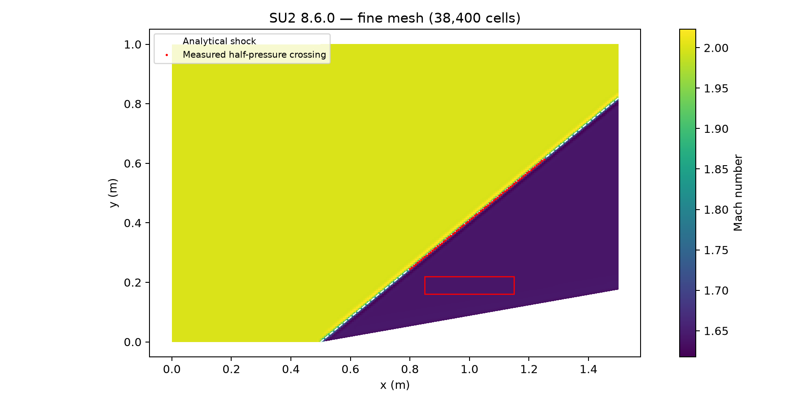
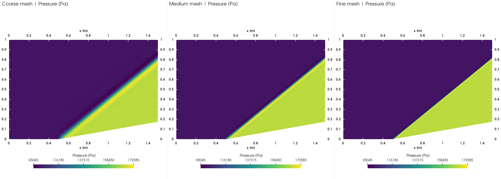

# How well does SU2 predict a shock wave?

A high-school-friendly research project about air moving over a small ramp at **Mach 2**: twice the local speed of sound.

We compare a computer simulation with an answer calculated from established equations. We ask: **How close are the shock angle, pressure, density, and speed?**

**Status:** Three real simulations finished. The Python checks passed. These are saved computer results, not wind-tunnel measurements. The project is a supersonic benchmark, not a hypersonic experiment.



The red box is the main measurement area. The dashed line is the theoretical shock. The red dots show the measured shock position. See [how measurements work](docs/METHOD.md).

## ParaView update — v1.3.0

Explore pressure, density and Mach number in native ParaView pictures, compare all three meshes with the same color scale, and reopen an editable ParaView state. The update also includes 801 line samples per mesh and a chart showing the shock transition. Read the [simple ParaView guide](docs/PARAVIEW_GUIDE.md) to understand and reproduce the views.



These views use the existing baseline simulations. They add ways to inspect the evidence; they do not change the original measurements.

## Checklist progress — v1.2.0

Completed 12 fresh simulations, compared all five measurement areas, and checked a second shock detector. The full suite now passes 18 tests. Read the [completed verification checklist and external review steps](docs/CHECKLIST.md), [research-paper draft](paper/research-draft.md), and [teacher review packet](docs/REVIEW_PACKET.md). The draft is not yet independently reviewed.

## Earlier update: v1.1.0

Six more CFD trials, 21 equation-only cases, five sampling areas, nine shock thresholds, and a faster shared measurement routine. Read the [expanded study](docs/EXPANDED_STUDY.md) for the data, timings and limits. The original baseline results remain unchanged.

## Start here

| What you want to do | Open this |
|---|---|
| Understand the project without coding | [Student guide](docs/STUDENT_GUIDE.md) |
| Explore the flow pictures and saved ParaView project | [ParaView guide](docs/PARAVIEW_GUIDE.md) |
| Install the tools and repeat the work | [Windows setup and reproduction](docs/SETUP.md) |
| See what was repeated before publication | [Reproducibility check](docs/REPRODUCIBILITY.md) |
| Read the results and limits | [Results explained](docs/RESULTS.md) |
| Check the exact settings and measurements | [Method](docs/METHOD.md) |
| Find the logs and data | [Data guide](docs/DATA_GUIDE.md) |
| Plan your next steps | [Next steps](docs/NEXT_STEPS.md) |
| Understand where the files came from | [File history](docs/PROVENANCE.md) |

## Download the two packages

Open the [v1.3.0 release](https://github.com/aeriswghs-ux/su2-wedge-research/releases/tag/v1.3.0).

- **SU2_Wedge_Setup_v1.3.0.zip:** current instructions, code, meshes, settings, and derived pictures. It also includes the recovered starter for reference. It does not include completed CFD flow files or the SU2/ParaView programs.
- **SU2_Wedge_Verified_Results_v1.3.0.zip:** everything in the setup package, plus completed runs and raw flow files needed to reopen the ParaView project and repeat the analysis.

The original starter ZIP was not found. The recovered starter came from its extracted folder. This is stated openly; we do not claim to have recovered the original ZIP byte for byte. The previously delivered verified-results ZIP was checked against all three published final flow files.

## What we found

| Quantity | Equation answer | Fine-mesh simulation | Relative error |
|---|---:|---:|---:|
| Shock angle | 39.313932° | 39.307805° | 0.015585% |
| Pressure after / before | 1.706579 | 1.706608 | 0.001730% |
| Density after / before | 1.458426 | 1.458484 | 0.004020% |
| Mach number after the shock | 1.640522 | 1.640550 | 0.001677% |

These averages come from a chosen area away from the ramp and shock. **Changing the area changes the answer.** A second area near the wall gives larger errors. We kept both sets of measurements. The result does not prove that SU2 is this accurate for every flow or everywhere in this flow.

## Quick check after setup

From the project folder, after following [SETUP.md](docs/SETUP.md):

```powershell
.\.venv\Scripts\python.exe -m pytest -q
.\.venv\Scripts\python.exe -m wedgeverify.shock --mach 2 --theta 10
```

The current suite has 18 checks, including the original 11 equation and mesh checks. Passing it does not replace running SU2.

## Tools and credit

The recorded simulation used Python 3.12.10, SU2 8.6.0, and ParaView 6.2.1. The Python package versions are recorded in [requirements-lock.txt](requirements-lock.txt). SU2 and ParaView are downloaded separately from their official sites.

This is an **AI- and computer-assisted numerical verification study**. AI assisted with code, execution, analysis and documentation. Saved simulations, automated tests and comparisons with established equations provide the evidence. Independent peer review remains a separate next step. See [sources](docs/REFERENCES.md) and [reuse notes](REUSE.md).


