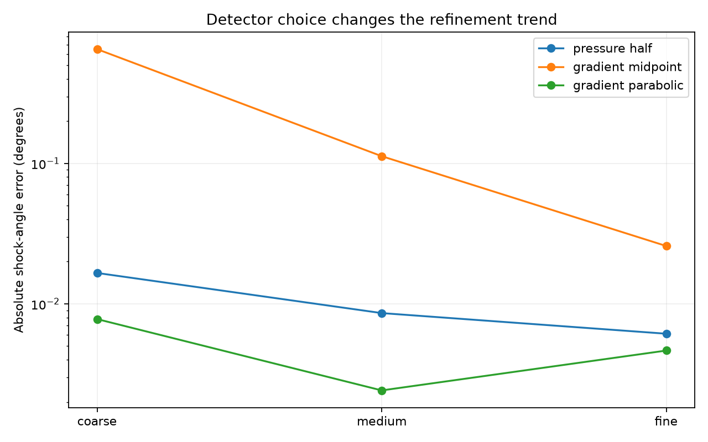

# Checklist: completed verification and external review steps

Status: November 27, 2026. This records what was actually done, not just planned.

- [x] Prepared plain-English explanations and optional learning exercises.
- [x] Repeated the automated checks: 18 tests passed.
- [x] Completed four fresh three-mesh studies: 12 successful, converged simulations.
- [x] Compared all five measurement areas, including the larger errors.
- [x] Tested CFL 10 on coarse, medium and fine meshes, twice each, with matched CFL 5 controls.
- [x] Added a pressure-gradient detector and compared both midpoint and refined versions with the pressure-crossing method.
- [x] Prepared a research-paper draft with methods, data, sources, limits and AI disclosure.
- [x] Prepared a teacher/mentor review packet.
- [ ] Another person repeats the study on a different computer.
- [ ] An independent reviewer checks the paper and the research team addresses their findings.

The repeat runs used the same computer and software environment. They do not satisfy independent reproduction. The review packet has not been sent; no recipient was supplied and no review has occurred.

## New solver results

Every batch runs coarse, medium and fine meshes. The fixed CFL order was 5, 10, 10, 5. Four threads were used. Timing includes process startup and solver output writing. Two repeats per setting are not a statistical performance guarantee.

| Mesh | CFL | Final iteration labels | Recorded times (seconds) |
|---|---:|---|---|
| coarse | 5.0 | 227, 227 | 1.92, 1.34 |
| coarse | 10.0 | 133, 133 | 1.27, 1.40 |
| medium | 5.0 | 333, 333 | 6.11, 3.88 |
| medium | 10.0 | 187, 187 | 3.12, 3.95 |
| fine | 5.0 | 541, 541 | 39.56, 35.21 |
| fine | 10.0 | 292, 292 | 23.18, 23.04 |

Maximum absolute change from the original reference across all 12 new runs:

- shock_angle_deg: 0.
- p2_p1: 0.
- rho2_rho1: 0.
- mach_2: 0.

CFL 10 met the convergence criteria in these cases. The baseline remains CFL 5 to keep the earlier work unchanged. This is evidence for these three meshes and settings, not a universal rule.

## Measurement findings

Across the five fine-mesh areas, pressure error is about 0.00153–0.00177%, density error is 0.00018–0.03002%, and Mach error is 0.00092–0.03803%. These are selected-area ranges, not confidence intervals.

The parabolic gradient detector gives errors of 0.007786°, 0.002418°, and 0.004649° on coarse, medium and fine meshes. Its error is not monotonic. The raw midpoint detector is also retained; we did not discard the less accurate method.



## Files to use next

- [Research draft](../paper/research-draft.md)
- [Review packet and optional learning exercises](REVIEW_PACKET.md)
- [All trial records](../datasets/v12-checklist/trial_comparison.csv)
- [All sampling-area errors](../datasets/v12-checklist/all_box_errors.csv)
- [Detector comparison](../datasets/v12-checklist/detector_comparison.csv)

## Repeat this checklist study

Use the full results package and the environment in SETUP.md. Choose a new name:

```powershell
.\.venv\Scripts\python.exe -m scripts.checklist_trials --su2 "C:\path\to\SU2\bin\SU2_CFD.exe" --name my-checklist
```

This creates datasets/my-checklist and runs/my-checklist-1 through -4. Each run contains its own tables and figures. The checklist analysis/report helpers currently target the published datasets/v12-checklist folder; they regenerate its derived tables and checklist, not the raw simulations. Use a copy when experimenting with the report.
