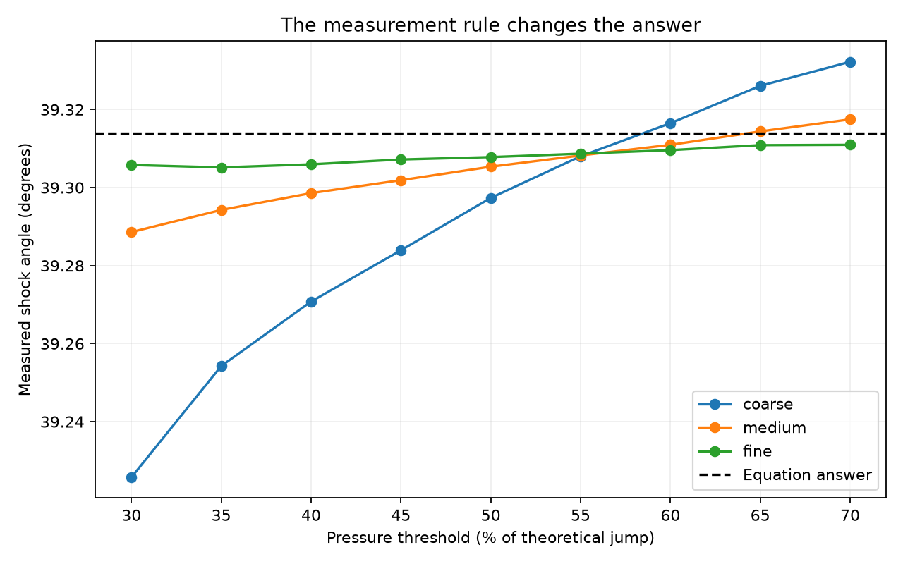

# More trials and faster measurements: v1.1.0

This update adds evidence without changing the original v1.0 results. Everything is still a simple, ideal-gas wedge study. The extra equation cases are **not** extra CFD cases.

## New datasets

| File in `datasets/v1.1/` | What it contains |
|---|---|
| `plan.json` | Choices recorded before these trials ran. |
| `theory_sweep.csv` | 21 equation-only cases: Mach 1.5, 2 and 3, each at seven turning angles. Includes cases with no attached solution. |
| `box_sensitivity.csv` | 15 measurements: five named areas on each of the three saved meshes. |
| `threshold_sensitivity.csv` | 27 shock fits: nine pressure thresholds on each mesh. |
| `cfd_trials.csv` | Six new medium-mesh SU2 runs, with timing, stopping status and measured answers. |
| `trial_01` through `trial_06` | Each trial's settings, mesh, full solver log, residual history and flow files. |
| `performance.json` | All 12 timing samples for each version of the shock-measurement routine. |

The boxes and thresholds were chosen before this batch was measured. The near-wall box is kept to show sensitivity. The sweep is not a statistical uncertainty study. Some equation-only cases have no attached-shock answer; blank physical values in those rows are intentional, not zeros.



The lines come from actual saved CFD fields. A finer mesh reduces the spread in this threshold sweep, but does not make the measurement rule irrelevant.

## What changed in the code?

The old shock routine searched the full point array again for each mesh column and each threshold. The new routine sorts the points once, then checks adjacent points with NumPy. The analysis and the new experiments use the same function.

Cell geometry and cell averages are also computed once and reused for different boxes and plots. This removes repeated calculations. The main analysis script is shorter, but the whole project has more code because it now includes experiment tools and regression checks. Code reduction is not achieved by hiding the science in unreadable one-line expressions.

## Measured speed

For three shock thresholds on the saved fine mesh, the median time fell from **13.58 milliseconds to 1.90 milliseconds**, about **7.15 times faster**. Each method had one warm-up call, followed by 12 timed samples in alternating order. Data loading, plotting and SU2 were excluded.

The three measured shock angles were unchanged in that benchmark. Regression checks compare both methods on all three meshes and nine thresholds. The frozen old function remains in `tests/reference_shock.py` so the timing comparison can be repeated.

This is a same-computer timing test of one routine. It does not mean that the whole project runs seven times faster.

## Six new solver trials

CFL controls the numerical step size. A larger value can help a steady calculation settle sooner, but it can also make some cases unstable. We tested CFL 2, 5 and 10 twice each, using the medium mesh and four threads. The order was 5, 2, 10, 10, 2, 5 to avoid simply comparing all early runs with all late runs.

| CFL | Final iteration label, both repeats | Times in seconds | Converged? |
|---|---:|---|---|
| 2 | 764 | 11.42, 13.03 | Both |
| 5 | 333 | 5.56, 4.47 | Both |
| 10 | 187 | 3.30, 2.61 | Both |

All six gave the same four reported measurements at the saved output precision. These tests support trying CFL 10 **for this medium-mesh case**. They do not prove it is best for every mesh or every flow. The baseline stays at CFL 5. Timing includes solver startup and writing output, and other computer activity can affect it. Two repeats are not enough for a strong statistical timing claim.

## Repeat the new work

Use the full results package and the Python environment from the setup guide. From the project folder:

```powershell
.\.venv\Scripts\python.exe -m pytest -q
.\.venv\Scripts\python.exe -m scripts.benchmark_measure
.\.venv\Scripts\python.exe -m scripts.expand_study --su2 "C:\path\to\SU2\bin\SU2_CFD.exe" --output runs/my-expanded-study
```

The experiment command refuses to overwrite an existing folder. It keeps failures and continues the planned batch; only converged, successful runs get physical measurements. The benchmark command writes a new `datasets/v1.1/performance.json` and will replace your local copy, so save it elsewhere first if you want to keep both timing records.

The full package now has 16 tests. The setup-only package skips the three checks that need saved reference flow files. The remaining checks can run without SU2. A passing test suite still does not replace checking solver logs.

## What to do next

1. Explain why moving a box changes the answer, using the new CSV rather than only the best box.
2. Plot all nine thresholds and report their spread without calling it a confidence interval.
3. Test CFL 10 on coarse and fine meshes before changing the default.
4. Try a shock detector based on the computed pressure gradient, without a theoretical pressure threshold.
5. Ask another person to repeat a run on another machine and record differences.

Keep the original release and this update separate when citing results. See the broader [next-step plan](NEXT_STEPS.md).
