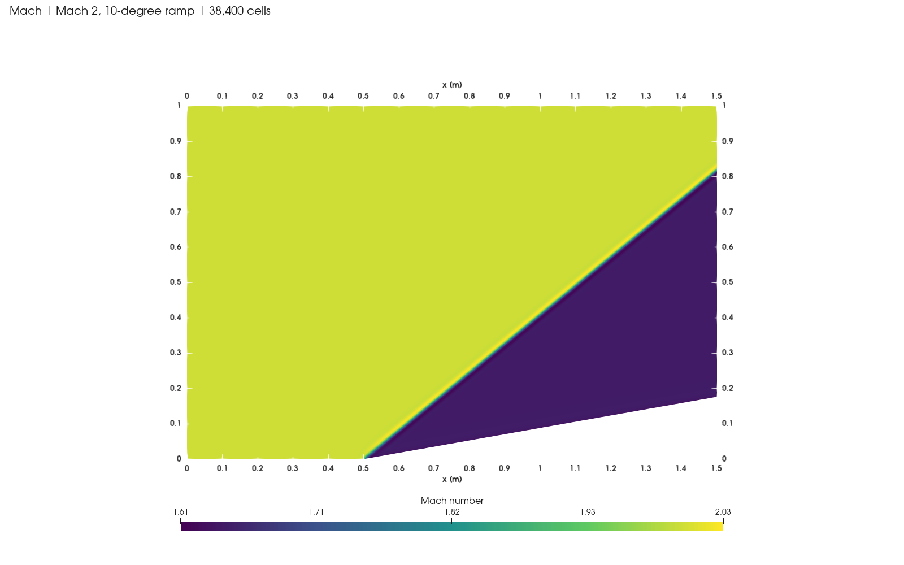
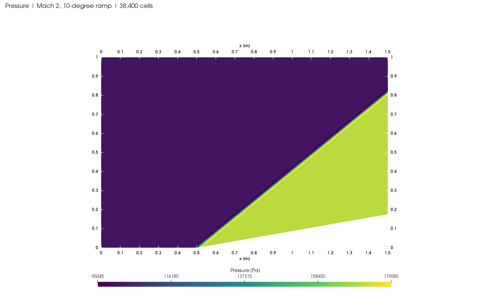
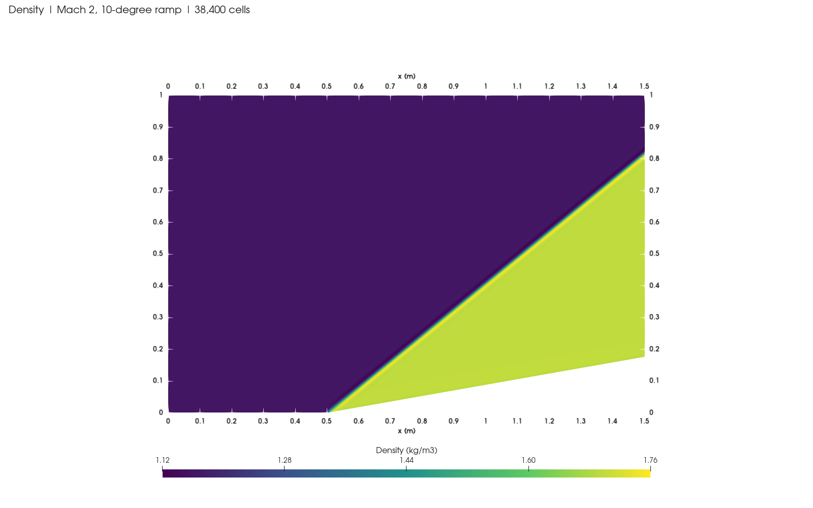
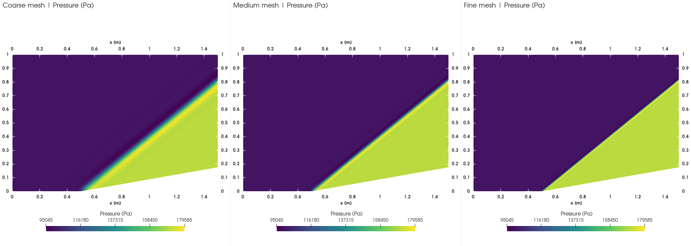
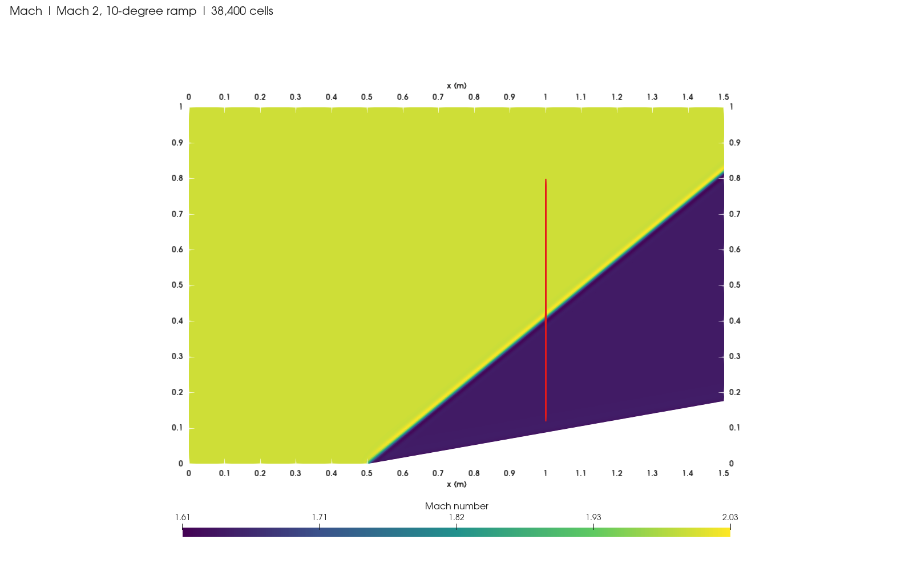
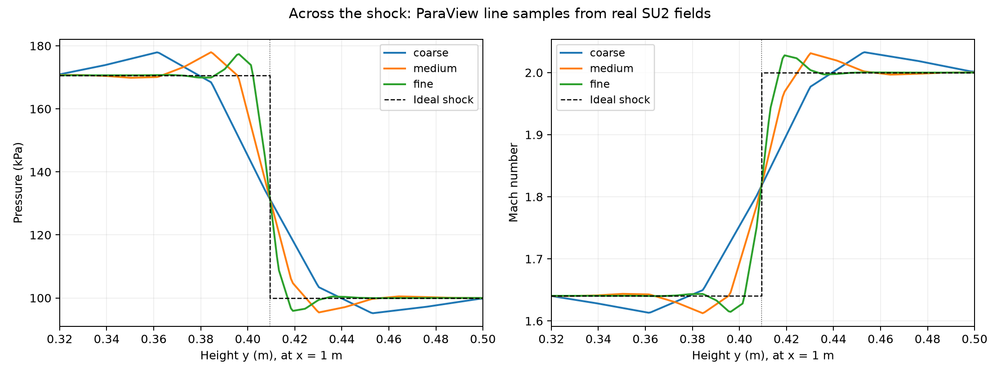

# Explore the shock with ParaView

ParaView turns the saved SU2 flow files into pictures and tables. This update uses the three existing baseline simulations. It does not add new solver runs or change their results.

## What the pictures mean



Air flows from left to right over the ramp. Mach number measures speed compared with the local speed of sound. The sharp diagonal change is the shock. The horizontal coordinate is x in metres; the vertical coordinate is y in metres. White space below the ramp is outside the flow region.



Pressure rises across the shock. The color bar uses pascals (Pa); 100,000 Pa is 100 kPa.



Density is mass per volume, in kilograms per cubic metre. It also rises across the shock.



The coarse, medium and fine meshes contain 2,400, 9,600 and 38,400 cells. All three views use the same pressure color scale. This makes their colors directly comparable. The shock transition becomes narrower as the mesh gets finer.

The fixed color ranges cover the values from all three baseline files:

| Field | Minimum | Maximum |
|---|---:|---:|
| Mach number | 1.606710 | 2.033147 |
| Pressure (Pa) | 95044.930 | 179585.266 |
| Density (kg/m3) | 1.119550 | 1.756582 |

These ranges include numerical overshoots near the shock. They are not uncertainty bounds. The pictures display the saved point values without an added smoothing filter.

## Take a slice through the shock



The red line is at x = 1 m. It runs from y = 0.12 m to y = 0.80 m. ParaView samples 801 equally spaced points on this line for each mesh. All sample points were inside the flow region, and all exported values were finite.



The profile chart zooms in on the shock. The black dashed step is the equation answer. The colored curves come from ParaView's line samples and are drawn with Matplotlib. The field pictures above are rendered directly by ParaView.

The small peaks and dips near the jump are numerical overshoots. They do not show extra physical shocks. More sample points make a smoother-looking curve, but do not add mesh resolution or new physical information. ParaView interpolates between saved values.

One simple position check finds where pressure crosses halfway between the theoretical upstream and downstream pressures:

| Mesh | Measured height (m) | Theory height (m) | Measured minus theory (mm) |
|---|---:|---:|---:|
| Coarse | 0.406558 | 0.409448 | -2.890 |
| Medium | 0.408072 | 0.409448 | -1.376 |
| Fine | 0.408823 | 0.409448 | -0.626 |

This check gets closer to theory for these three meshes. It measures one line only. It does not replace the fitted shock angle or establish a formal convergence rate. The exact values are in [profile_checks.json](../paraview/profile_checks.json).

## Open the saved project

Use the **verified-results ZIP** or a full repository checkout. The setup ZIP includes the pictures and state, but omits the raw flow files required to reopen or regenerate the views.

1. Open ParaView 6.2.1.
2. Choose **File → Load State** and select `paraview/wedge.pvsm`.
3. If ParaView asks where the data lives, select this project's `results/raw` folder and locate the three files named `coarse_flow.vtu`, `medium_flow.vtu` and `fine_flow.vtu`.
4. Explore the field views and the pressure comparison layout. The pipeline also contains each mesh's line-sampling filter.

The saved state uses relative paths. An automated load check from the project folder confirmed all three mesh cell counts. Manual interactive use on another computer has not been checked.

## Rebuild the pictures and tables

First follow [the Python setup](SETUP.md). Install the non-MPI Windows ParaView 6.2.1 build from [ParaView's official download page](https://www.paraview.org/download/). Run these commands in the project folder, replacing the example program path:

```powershell
& "C:\path\to\ParaView\bin\pvpython.exe" --force-offscreen-rendering scripts/paraview_visuals.py *> paraview/render.log
if ($LASTEXITCODE -ne 0) { throw "ParaView rendering failed. Read paraview/render.log." }
.\.venv\Scripts\python.exe -m scripts.plot_paraview_profiles *> paraview/profile.log
if ($LASTEXITCODE -ne 0) { throw "Profile checks failed. Read paraview/profile.log." }
& "C:\path\to\ParaView\bin\pvpython.exe" --force-offscreen-rendering scripts/verify_paraview_state.py *> paraview/state_check.log
if ($LASTEXITCODE -ne 0) { throw "Saved state check failed. Read paraview/state_check.log." }
```

These commands overwrite the derived files in `paraview/`. Keep a copy first if you have edited them. Use ParaView's own `pvpython.exe` for rendering and state loading; use the ordinary project Python environment for the profile chart. No extra pip packages are needed inside ParaView.

## Evidence and known rendering messages

- [manifest.json](../paraview/manifest.json) records input SHA-256 fingerprints, point counts, sample settings and color ranges.
- [state_check.json](../paraview/state_check.json) records the reopened mesh cell counts.
- [Coarse](../paraview/coarse_profile.csv), [medium](../paraview/medium_profile.csv) and [fine](../paraview/fine_profile.csv) CSV files contain x, y, pressure, density and Mach number with units in their column names.
- [render.log](../paraview/render.log), [profile.log](../paraview/profile.log) and [state_check.log](../paraview/state_check.log) retain execution messages. Earlier `attempt*.log` files preserve failed or less readable rendering attempts. Personal paths are replaced in public log copies.

The installed ParaView build reports `MaskParser is not initialized!` while rendering text. It also cannot save its user settings in this restricted environment. These messages are retained, not hidden. The final images were checked visually for readable titles, numerical color labels and layout. The scripts completed, exported valid samples and reopened the saved state. This does not establish that every ParaView feature works on this computer.

For the underlying APIs, see ParaView's official [Python documentation](https://www.paraview.org/paraview-docs/latest/python/paraview.simple.html), [file and image output documentation](https://www.paraview.org/paraview-docs/latest/python/paraview.simple.io.html), and [Plot Over Line documentation](https://www.paraview.org/paraview-docs/nightly/python/paraview.simple.__init__.PlotOverLine.html).

## Next useful steps

1. Ask another person to reopen the state and repeat the commands on a second computer.
2. Compare profiles at more x locations, keeping the same sampling rule for each mesh.
3. If studying overshoots, run a separately named case with a different reconstruction or limiter setting. Preserve both cases and compare their accuracy and shock width.
4. Have a teacher or mentor review the assumptions and figures before presenting the study.
