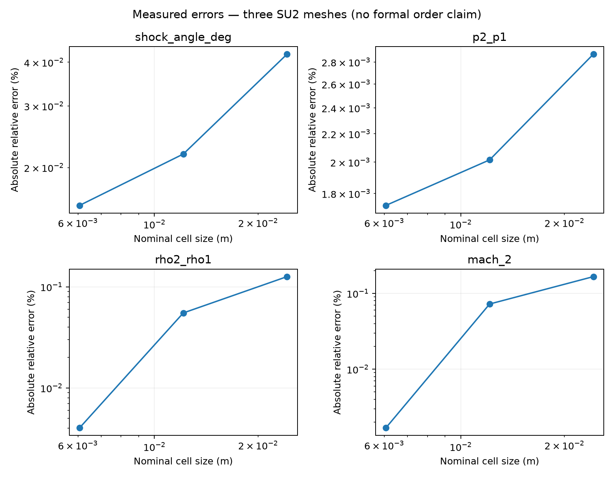
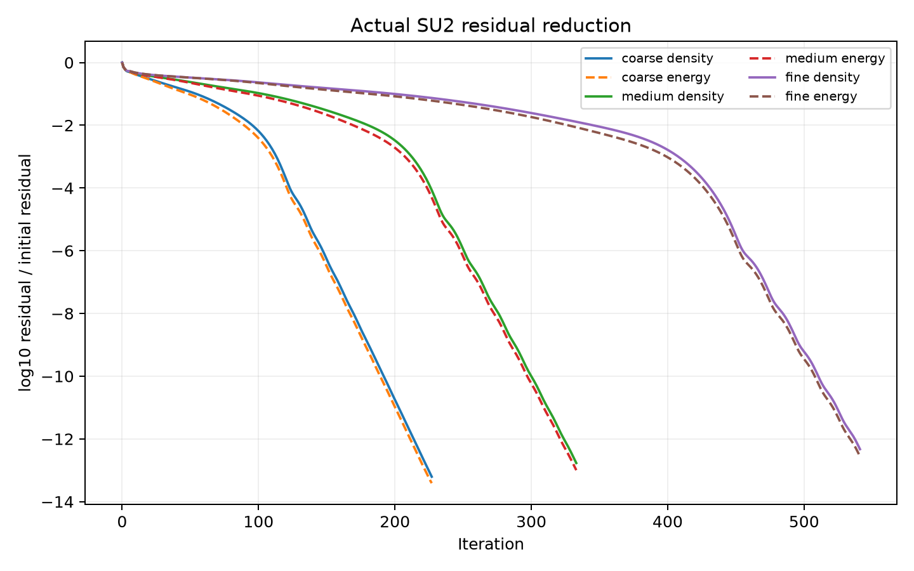

# What the simulations show

The three recorded SU2 runs finished and met the chosen stopping checks. They used 2,400, 9,600, and 38,400 cells. Each refinement halves the spacing in both directions, which gives four times as many cells.

## Main comparison

| Mesh | Shock angle (degrees) | Pressure ratio | Density ratio | Mach number after shock |
|---|---:|---:|---:|---:|
| Equation answer | 39.313932 | 1.706579 | 1.458426 | 1.640522 |
| Coarse | 39.297341 | 1.706628 | 1.460266 | 1.643254 |
| Medium | 39.305338 | 1.706613 | 1.459230 | 1.641710 |
| Fine | 39.307805 | 1.706608 | 1.458484 | 1.640550 |

All four errors decrease in the main measurement area as the mesh gets finer. The fine-mesh errors are each below 0.02%. That statement applies to this measurement method and this area, not the whole flow.

The horizontal axis is a representative cell size. Smaller values mean a finer mesh. The vertical axis is relative error in percent. Both axes use a logarithmic scale: equal steps represent multiplication, not addition.

## Did the calculations settle?

Yes, under the final stopping rule. SU2 required both the density and energy residuals to fall below `1e-8` (0.00000001). It reported this for every final run.

| Mesh | Final iteration label | Density residual, log10 | Energy residual, log10 |
|---|---:|---:|---:|
| Coarse | 227 | -13.5554 | -8.0262 |
| Medium | 333 | -13.5653 | -8.0576 |
| Fine | 541 | -13.5722 | -8.0696 |

Iteration labels start at zero. A log10 value of -8 means a residual of 10^-8. The original residuals have different units and scales, so do not compare density and energy values as if they were the same kind of error.

This graph shows how far each residual fell relative to its own starting value. A small residual is evidence that the solver settled. It does not by itself prove that the mesh is fine enough or that the physical model matches reality.

## The measurement box matters

The main box is x = 0.85 to 1.15 m and y = 0.16 to 0.22 m. It has space between it and the wall and shock.

We also checked an earlier box: x = 0.8 to 1.2 m and y = 0.12 to 0.20 m. This box approaches the wall near its right side. It was moved for that geometric reason. We retained its results in the CSV under `alternate_region_*`.

| Error in the earlier box | Coarse | Medium | Fine |
|---|---:|---:|---:|
| Pressure relative error | 0.01914% | 0.000682% | 0.001609% |

Here, pressure error does **not** decrease at every step. Fine-mesh density and Mach errors are about 0.0300% and 0.0380% in that box. This prevents a claim that the best-looking main-box results apply everywhere.

The shock angle also depends on where we place the edge inside the blurred shock. Changing the pressure threshold from 40% to 60% of the expected jump gives fine-mesh angles from about 39.30595° to 39.30959°. This is a sensitivity range, not a statistical confidence interval.

## Conservation checks

We estimated the mass and energy passing through the boundary from the saved flow fields. The imbalances are around 0.000001% or smaller in these files. Keep the scientific-notation values in the [CSV](../results/verified_measurements.csv); rounding can make small values look like zero.

These are estimates from exported values, not the exact fluxes that SU2 uses internally. The fine-mesh average total-enthalpy difference in the main box is about 0.00112%. These checks support consistency, but should not be described as exact conservation proofs.

## What we can and cannot say

- **Checked:** three simulations ran; stopping checks passed; logs and fields exist; an independent ParaView reader opened the data.
- **Supported by the numbers:** this simple case agrees closely with the equations using the stated method.
- **Still needs study:** measurement-box choices, a different shock detector, boundary placement, and whether further refinement follows a stable pattern.
- **Not shown:** real-air experiments, friction, heating, hypersonic gas effects, or accuracy for other shapes and flows.

There is no claim of a formal convergence order, peer review, or physical validation. See the [full execution record](../results/VERIFIED_REPORT.md) for the original technical audit.
