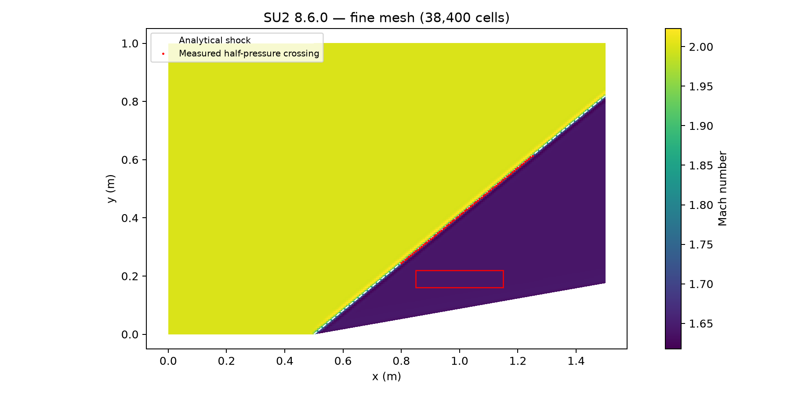
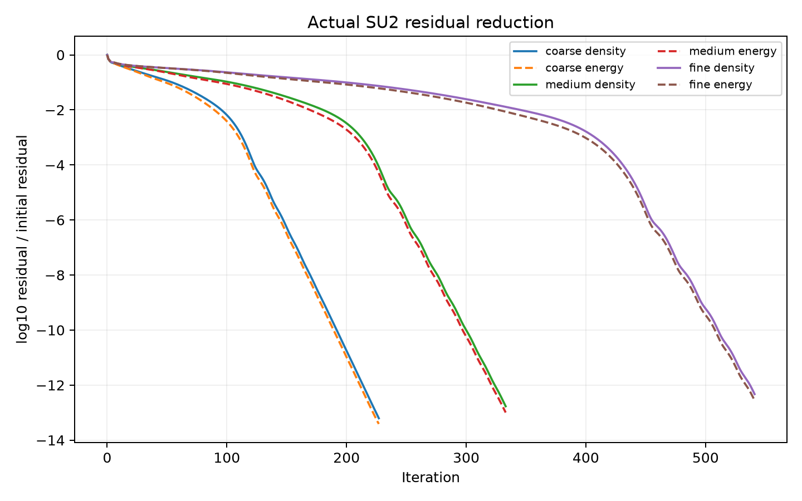

# Checking SU2 against shock-wave equations

**AI- and computer-assisted numerical verification study — working paper.**

The study's evidence consists of saved solver output, automated checks and comparisons with analytical shock relations. The verification findings are supported by these recorded checks. Independent peer review has not been completed.

## Abstract

This study compares SU2 with an equation-based answer for air flowing over a 10-degree ramp at Mach 2. The model is two dimensional, steady and inviscid. It uses a perfect gas with a specific-heat ratio of 1.4. Three meshes contain 2,400, 9,600 and 38,400 cells. The comparison measures shock angle, pressure ratio, density ratio and downstream Mach number. In the selected main area, all four fine-mesh errors are below 0.02%. However, the answer changes when the measurement area changes. Across five areas on the fine mesh, density error ranges from about 0.00018% to 0.03002%, and Mach error ranges from 0.00092% to 0.03803%. A second shock detector uses the computed pressure gradient without a theoretical pressure threshold. Its refined fine-mesh angle is 39.30928 degrees, compared with the equation answer of 39.31393 degrees. Its error does not decrease at every refinement step. The evidence supports close agreement for this case, but does not establish formal convergence order or physical validation.

## 1. Research question

How accurately does SU2 predict idealized supersonic wedge flow when compared with analytical shock relations?

A ramp is useful because the flow has an established equation-based answer. This lets us check the numerical method with a small, repeatable problem. The [SU2 wedge tutorial](https://su2code.github.io/tutorials/Inviscid_Wedge/) gives a related Euler-flow example and explains its boundary conditions.

This is verification: checking the numerical solution against the chosen equations. It is not validation against a wind-tunnel experiment. Mach 2 is supersonic. This study does not represent hypersonic heating or real-gas chemistry.

## 2. Theory and assumptions

The incoming Mach number is 2.0. The ramp turns the air by 10 degrees. Upstream pressure is 100,000 Pa and temperature is 300 K. The model uses gamma = 1.4 and gas constant R = 287.058 J/(kg K).

The weak attached-shock angle follows the theta–beta–Mach relation:

```text
tan(theta) = 2 cot(beta) [M1² sin²(beta) - 1]
             / [M1² (gamma + cos(2 beta)) + 2]
```

Here, theta is the ramp angle and beta is the shock angle. The code finds the weak root. The normal Mach number is M1 sin(beta). Normal-shock relations then give the pressure and density ratios and downstream Mach number. The [NASA Glenn explanation](https://www.grc.nasa.gov/www/k-12/airplane/oblique.html) gives these relations and their assumptions.

The equation answer is beta = 39.313932 degrees, p2/p1 = 1.706579, rho2/rho1 = 1.458426 and M2 = 1.640522. The Python tests check rounded reference values, limiting cases, invalid inputs and conservation relations. Synthetic fields used in detector unit tests are not reported as CFD evidence.

## 3. Numerical method

The channel is 1.5 m long and 1 m high. The ramp starts at x = 0.5 m. Its surface is y = max(x - 0.5, 0) tan(10 degrees). The three meshes have 60 × 40, 120 × 80 and 240 × 160 quadrilateral cells.

SU2 8.6.0 solves the steady Euler equations. The inlet specifies supersonic flow. The upper and lower surfaces are slip walls. The outlet follows the tutorial's supersonic-exit approach. There is no viscosity or boundary layer.

The baseline uses HLLC fluxes, second-order MUSCL reconstruction without a slope limiter, weighted least-squares gradients and implicit Euler stepping. CFL is 5. Both density and energy RMS residuals must be below 10^-8. The maximum is 4,000 iterations. Exact configurations are saved with each run.

Earlier attempts are retained. A density-only stopping check ended the original coarse attempt sooner. A later energy target of 10^-9 could not be reached before the iteration limit. These attempts are not labeled as meeting the final two-field rule.

## 4. Measurement methods

The main sample area is x = 0.85–1.15 m and y = 0.16–0.22 m. The code averages the four corner values of each cell, then weights the cell averages by area. Four other areas are also retained. Their coordinates are recorded in the experiment plan.

The original shock detector finds a pressure crossing on vertical mesh columns between x = 0.8 and 1.25 m. The threshold is half the theoretical pressure jump. A line is fitted to the crossing locations with a free intercept. Thresholds from 30% to 70% test sensitivity.

The second detector finds the strongest negative vertical pressure gradient in each column. It excludes a 0.04 m strip above the ramp and points above y = 0.95 m. It does not use the theoretical pressure jump or shock angle. We retain the edge-midpoint result and a three-point parabolic refinement. Both methods still depend on spatial bounds and grid resolution; independence from the theoretical pressure threshold is not independence from all choices.

## 5. Baseline results

| Quantity | Equation answer | Coarse | Medium | Fine |
|---|---:|---:|---:|---:|
| Shock angle, degrees | 39.313932 | 39.297341 | 39.305338 | 39.307805 |
| Pressure ratio | 1.706579 | 1.706628 | 1.706613 | 1.706608 |
| Density ratio | 1.458426 | 1.460266 | 1.459230 | 1.458484 |
| Downstream Mach | 1.640522 | 1.643254 | 1.641710 | 1.640550 |

All final baseline runs met both stopping checks. Residual histories are included in the repository. Small residuals do not prove mesh independence.





These figures use the saved baseline data. The field plot compares the theoretical shock line with measured crossing points.

## 6. Sensitivity results

Across all five fine-mesh areas, pressure error ranges from 0.00153% to 0.00177%. Density error ranges from 0.00018% to 0.03002%. Mach error ranges from 0.00092% to 0.03803%. These are observed ranges over five selected areas, not statistical confidence intervals or whole-domain error bounds.

| Shock method: absolute error in degrees | Coarse | Medium | Fine |
|---|---:|---:|---:|
| Half-pressure crossing | 0.016591 | 0.008594 | 0.006127 |
| Gradient, edge midpoint | 0.651224 | 0.112635 | 0.025823 |
| Gradient, parabolic refinement | 0.007786 | 0.002418 | 0.004649 |

Parabolic refinement reduces the midpoint error for these fields. Its error is larger on the fine mesh than on the medium mesh. We therefore cannot claim that every reasonable detector has steadily decreasing error.

The additional CFL trials and all per-run results are described in [the checklist evidence](../docs/CHECKLIST.md). They test whether a larger numerical step reaches the same measured solution. They do not change the original reference settings.

## 7. Conservation, repeatability and limits

Boundary mass and energy estimates use trapezoidal integration of exported nodal data. They are not the solver's internal face-flux balances. Float32 export and quadrature affect these estimates. Small values support consistency but are not exact conservation proofs.

Repeated runs on the same computer support repeatability under the recorded environment. A second person has not yet repeated the study on another computer. Software versions, configurations, raw logs and data are available for that task.

Other limits include fixed domain boundaries, only three baseline mesh sizes, unlimited reconstruction near a discontinuity, and selected measurement areas. The study does not establish formal convergence order. It does not cover viscous flow, wall heating, real-gas effects or experimental validation.

## 8. Conclusion

SU2 agrees closely with the analytical weak-shock answer for the selected Mach 2 wedge case. The main-area fine-mesh errors are below 0.02%. Wider measurement checks show that the exact error depends on the area and shock detector. The result supports this controlled verification case, not a general accuracy guarantee for SU2.

The next independent check is a repeat by another person on another computer. A teacher or mentor should review the theory, numerical choices and limits before the paper is submitted or presented as finished research.

## Sources and assistance

- SU2 Project, [Inviscid Supersonic Wedge](https://su2code.github.io/tutorials/Inviscid_Wedge/). Consulted for the benchmark setup and boundary behavior; tutorial and executable versions differ.
- NASA Glenn Research Center, [Oblique Shock Waves](https://www.grc.nasa.gov/www/k-12/airplane/oblique.html). Consulted for the shock relations and assumptions.
- [Project repository](https://github.com/aeriswghs-ux/su2-wedge-research), with versioned data, code and execution records.

AI and computer tools assisted with code, execution, analysis and writing. The methods and raw evidence are supplied for inspection and reproduction. The numerical findings apply to the stated model and settings; they are not a universal mathematical proof or evidence of physical validation.

