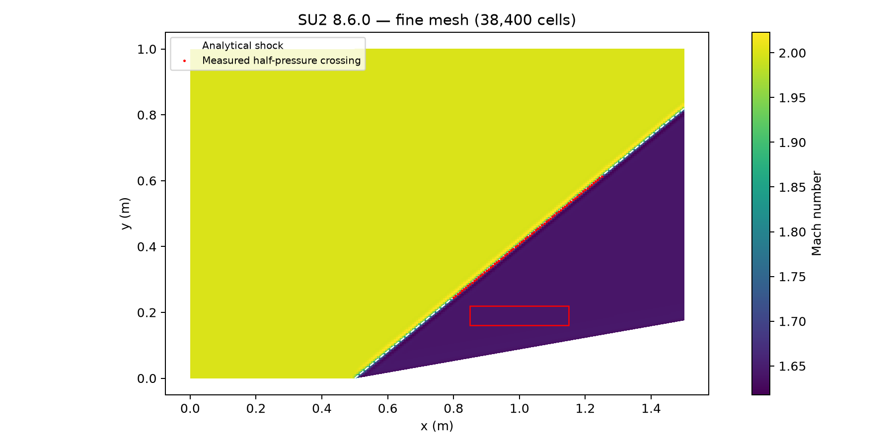
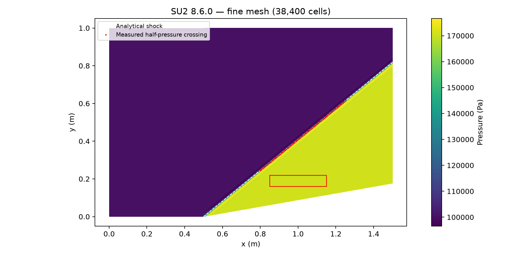
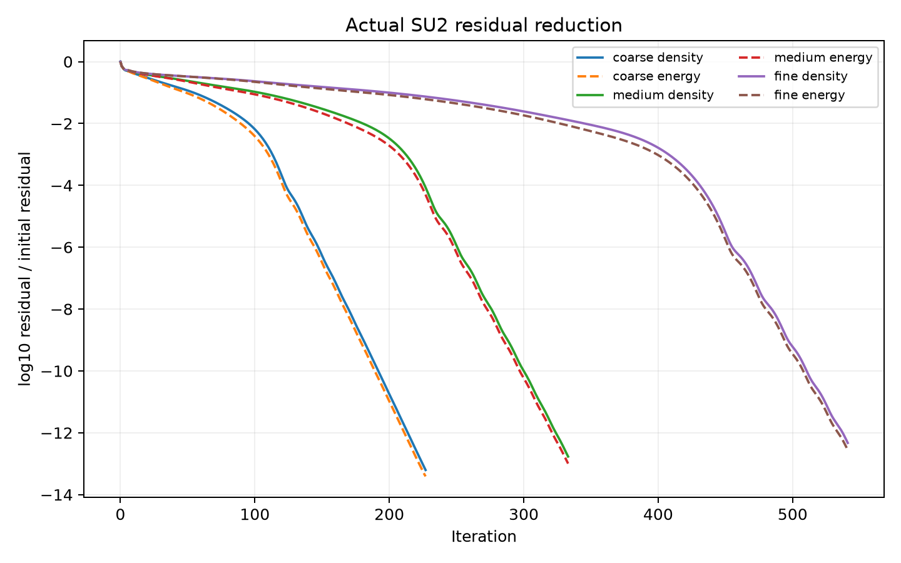
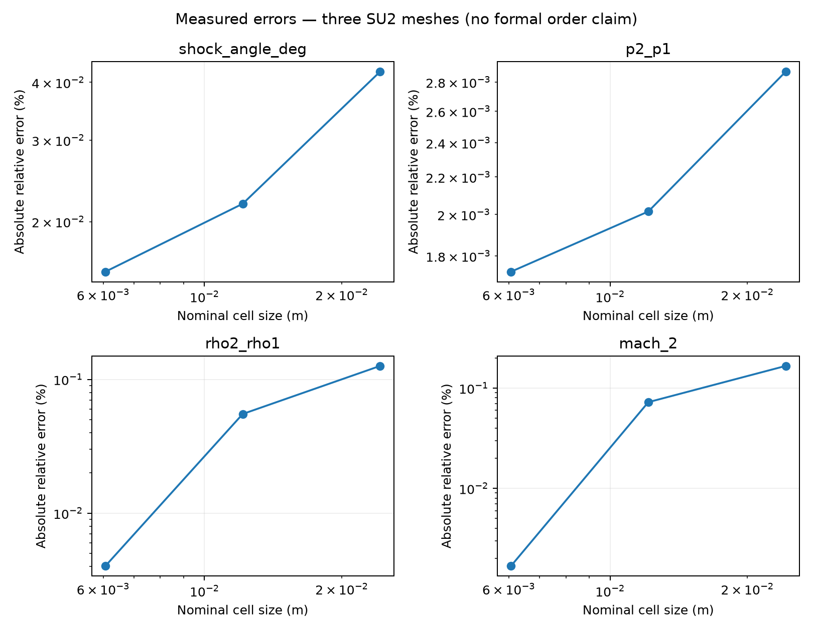

# Verified Windows execution report

Run date: November 26, 2026 (America/Chicago).

## Scope and provenance

This is a Mach 2 supersonic, two-dimensional, steady Euler wedge benchmark with a 10-degree turn and a perfect gas (gamma 1.4). It is not a hypersonic, viscous, heat-transfer, or physical-validation study.

The connected Windows desktop was accessible. The source project and Research brief.md were inspected at `[DOWNLOADS]/su2-wedge-verification` and copied into this folder. The exact named starter ZIP was not found in the searched user directory. Therefore archive integrity and identity cannot be verified. Original source-file hashes are saved in results/raw/source_hashes.csv. No prior conversation result was treated as a new measurement.

## Software and prerequisites

Python 3.12.10 and all four required packages were already present; all 11 tests passed locally. Exact package versions are in results/software_versions_verified.txt. SU2 8.6.0 Windows OpenMP and ParaView 6.2.1 Windows non-MPI portable packages were downloaded from official servers and extracted under the parent tools directory. SU2 executed with OMP_NUM_THREADS=4. No MPI installation is required for these selected builds. ParaView GUI startup and pvpython version were verified; its VTK reader independently read the result files. No system PATH modification was needed.

Download URLs:

- https://github.com/su2code/SU2/releases/download/v8.6.0/SU2_v8.6.0_win64-omp.zip
- https://www.paraview.org/files/v6.2/ParaView-6.2.1-Windows-Python3.12-msvc2017-AMD64.zip

Local download SHA-256 hashes are in results/raw/download_sha256.txt. These establish local artifact identity, not independent publisher signature verification. A Windows CIM inventory query was access-denied; successful execution establishes the needed runtime availability, but does not constitute a complete system inventory.

## Configuration diagnosis

The starter configuration parsed and ran without a fatal configuration error. Mesh orientations were accepted. The original coarse run stopped at iteration 177 using only density residuals. Those outputs remain in results/raw/initial_coarse. A stricter trial required both density and energy below 1e-9; coarse and medium reached 4000 iterations with energy plateauing near log10 residual -8.4 and -8.7. Those attempts are preserved in results/raw/strict_attempt and their configs in results/raw/strict_configs. The final common criterion requires both fields below 1e-8. All three final runs satisfy it. A solver success exit alone is not the convergence evidence; the final convergence tables and history files are.

The starter uses dimensional residuals, so absolute density and energy values cannot be compared as equivalent relative tolerances. Residual-reduction plots normalize each field by its own initial value. Nonfatal warnings about surface pressure-drop output and inactive time-convergence monitoring do not invalidate this steady run. No pressure-drop result is claimed.

## Measurements

Shock angle: on mesh columns between x=0.8 and 1.25 m, linearly interpolate the downward pressure crossing at half the analytical pressure jump, then fit y=a(x-0.5)+b with a free intercept. Repeat at 40% and 60% of the pressure jump for measurement sensitivity. The threshold uses the analytical pressure jump explicitly; this is not a fully theory-independent shock detector.

Downstream properties: area-weighted mean of four-node cell averages for cell centers within x=0.85–1.15 m and y=0.16–0.22 m. The same physical region is used on all meshes. Its boundary includes slightly different cells at different resolutions. Raw VTU point values are float32.

| Mesh | Cells | Shock angle (deg) | p2/p1 | rho2/rho1 | M2 |
|---|---:|---:|---:|---:|---:|
| Analytical | — | 39.313932 | 1.706579 | 1.458426 | 1.640522 |
| coarse | 2400 | 39.297341 | 1.706628 | 1.460266 | 1.643254 |
| medium | 9600 | 39.305338 | 1.706613 | 1.459230 | 1.641710 |
| fine | 38400 | 39.307805 | 1.706608 | 1.458484 | 1.640550 |

### Absolute relative errors (%)

| Mesh | Shock angle | Pressure ratio | Density ratio | Downstream Mach |
|---|---:|---:|---:|---:|
| coarse | 0.042200 | 0.002876 | 0.126210 | 0.166518 |
| medium | 0.021860 | 0.002016 | 0.055170 | 0.072420 |
| fine | 0.015585 | 0.001730 | 0.004020 | 0.001677 |

### Convergence and conservation

| Mesh | Last iteration (zero based) | log10 RMS density | log10 RMS energy | Boundary mass imbalance (%) | Boundary energy imbalance (%) | Regional total enthalpy error (%) |
|---|---:|---:|---:|---:|---:|---:|
| coarse | 227 | -13.5554 | -8.0262 | 0.000001 | 0.000000 | 0.006935 |
| medium | 333 | -13.5653 | -8.0576 | 0.000000 | 0.000000 | 0.002447 |
| fine | 541 | -13.5722 | -8.0696 | 0.000000 | 0.000001 | 0.001116 |

Boundary checks use trapezoidal integration of exported nodal momentum and enthalpy flux on all four boundaries, per unit depth. They are post-processing consistency checks, not exact SU2 numerical face-flux balances. Interpolation, shock smearing and float32 export affect these estimates.

### Grid trend and measurement sensitivity

- shock_angle_deg: absolute error decreases on each refinement.
- p2_p1: absolute error decreases on each refinement.
- rho2_rho1: absolute error decreases on each refinement.
- mach_2: absolute error decreases on each refinement.
- coarse shock angles for 40–60% thresholds span 39.270780 to 39.316494 degrees.
- medium shock angles for 40–60% thresholds span 39.298571 to 39.310943 degrees.
- fine shock angles for 40–60% thresholds span 39.305950 to 39.309591 degrees.

No formal order of accuracy or grid-independent solution is claimed. Three grids, a captured discontinuity, a fixed sampling window and threshold sensitivity are insufficient by themselves to establish asymptotic order. The unlimited second-order reconstruction produces small upstream/downstream overshoots near the shock; these are numerical artifacts, not new physical phenomena.

## Evidence labels

- **Verified:** executable versions, 11 passing tests, actual solver executions, saved outputs, final stopping criteria, and independent ParaView readback.
- **Numerically supported:** tabulated agreement with analytical shock relations for this setup and measurement method.
- **Preliminary:** shock-position extraction and exported-field conservation estimates; inspect sensitivity before making stronger claims.
- **Unresolved:** original ZIP identity, systematic domain-boundary and sampling-window sensitivity, exact numerical face-flux balances, formal convergence order, and mentor review.

## Figures

## Sources actually consulted

- SU2, Inviscid Supersonic Wedge tutorial: https://su2code.github.io/tutorials/Inviscid_Wedge/ — Euler/HLLC setup and boundary behavior.
- NASA Glenn, Oblique Shock Waves: https://www.grc.nasa.gov/www/k-12/airplane/oblique.html — shock relations and conservation assumptions.
- SU2 downloads: https://su2code.github.io/download.html
- ParaView downloads: https://www.paraview.org/download/
- The old SU2 Windows-Installation page explicitly applies only to version 6.2.0 and lower; it was not used as current-version runtime evidence.

## Sampling-window sensitivity

A second, initially inspected rectangle (x=0.8–1.2 m, y=0.12–0.20 m) approaches the wall near its right edge. It is retained in the CSV as alternate_region_* rather than discarded. In that window, pressure relative errors are approximately 0.01914%, 0.000682%, and 0.001609%: they are not monotonic. Fine-mesh density and Mach errors there are approximately 0.0300% and 0.0380%, larger than in the main region. The primary rectangle was moved to x=0.85–1.15 m, y=0.16–0.22 m to provide physical clearance from the wall and shock. This sensitivity limits claims of uniform accuracy and formal order; the main-region numbers should not be generalized to the entire downstream flow.

ParaView readback completed, with a nonfatal warning that saving user settings outside the workspace was denied. Data readback itself succeeded.
